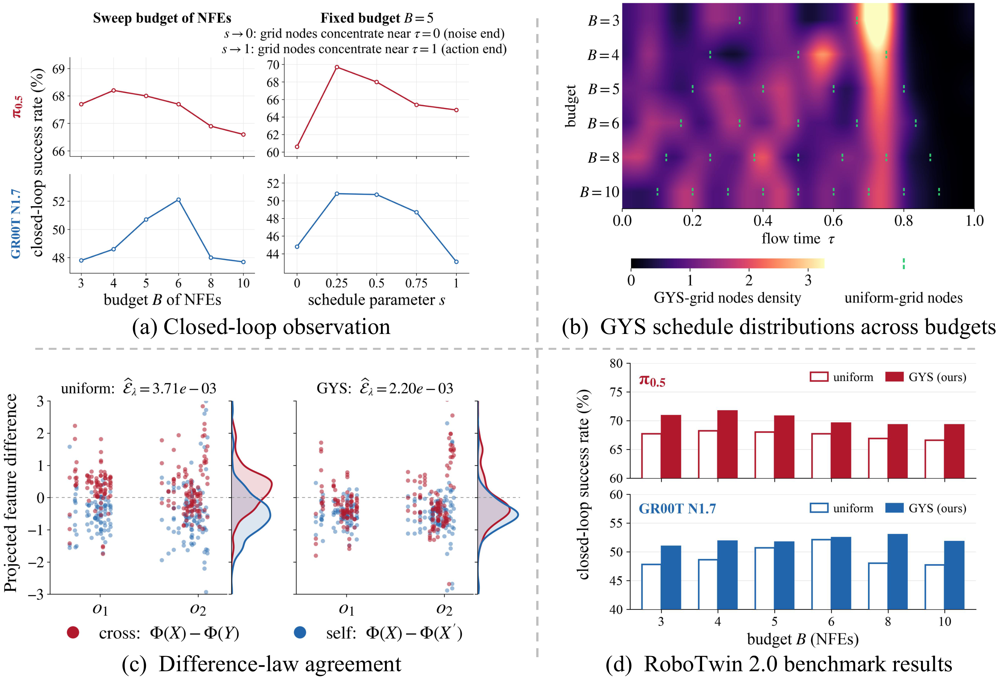

<h1 align="center">Ground Your Steps: Optimizing Sampling Schedules in Flow Matching Robot Policies</h1>

<p align="center">
  Licheng Yang<sup>1,2</sup>, Yonghao He<sup>2,†</sup>, Lingfeng Qian<sup>2</sup>, Xin Shi<sup>2</sup>, Wei Sui<sup>2,✉︎</sup>, Hu Su<sup>1,✉︎</sup>
</p>

<p align="center">
  <sup>1</sup> State Key Laboratory of Multimodal Artificial Intelligence Systems, Institute of Automation, Chinese&nbsp;Academy&nbsp;of&nbsp;Sciences<br>
  <sup>2</sup> D-Robotics<br>
  <sup>†</sup> Project lead &emsp; <sup>✉︎</sup> Corresponding authors
</p>

## 1. Introduction

> *Flow-matching VLAs default to uniform sampling schedules, so what happens when the schedule is no longer uniform?*

<p align="center">
  
</p>

Flow-matching VLA policies generate action chunks by integrating a learned velocity field from noise to actions with only a few neural function evaluations (NFEs). Closed-loop success indeed varies non-monotonically with the NFE budget and changes with node placement at a fixed budget (a). This raises the question of how to choose the schedule so that the generated actions match the demonstrations.

**Ground Your Steps (GYS)** is a training-free method that optimizes the sampling schedule offline for each task and NFE budget. GYS minimizes the energy distance between two pairwise-difference distributions of action chunks (c), generated-demonstrated and generated-generated, each transformed by a truncated fractional-difference operator and paired with observation summaries, and delivers a non-uniform schedule (b). The two distributions coincide when the generated and demonstrated action distributions match, so the objective grounds the schedule in the demonstrations. The optimized schedule replaces the uniform grid at deployment and raises the success rate across budgets, without changing the policy weights or the inference cost (d).

## 2. Getting Started

### Environment

GYS runs in the PyTorch environment of the target policy. Install [π0.5 (openpi, PyTorch)](https://github.com/Physical-Intelligence/openpi/tree/3e0325a#pytorch-support) or [GR00T N1.7](https://github.com/NVIDIA/Isaac-GR00T/tree/n1.7-release#installation), then install GYS in the same environment.

```bash
git clone https://github.com/LichengYang03/GroundYourSteps.git
cd GroundYourSteps
uv pip install -e '.[robotwin]'
```

### Data and Checkpoints

GYS calibrates on [RoboTwin 2.0](https://github.com/RoboTwin-Platform/RoboTwin) demonstrations. Each task directory is organized as follows.

```
datasets/robotwin/clean/<task>/aloha-agilex_clean_50/
├── data/episode*.hdf5
└── instructions/episode*.json
```

The policies are RoboTwin fine-tuned checkpoints.

- **π0.5**: a PyTorch checkpoint directory with `model.safetensors` and `assets/**/norm_stats.json`.
- **GR00T N1.7**: a checkpoint directory with its processor.

Set the paths in the configuration files under [`configs/`](configs).

| File | Fields |
| --- | --- |
| [`data/robotwin_clean.yaml`](configs/data/robotwin_clean.yaml) | `dataset_root` (keep `{task}` as the task placeholder) |
| [`policy/pi05_robotwin.yaml`](configs/policy/pi05_robotwin.yaml) | `openpi_root`, `checkpoint` |
| [`policy/groot_robotwin.yaml`](configs/policy/groot_robotwin.yaml) | `groot_root`, `checkpoint`, `embodiment_tag` |

## 3. Optimization

`gys solve` optimizes the Euler schedule of a frozen policy for one task and one NFE budget. Run it from the repository root.

### π0.5

```bash
gys solve --config configs/robotwin_pi05.yaml --task lift_pot --budget 8
```

### GR00T N1.7

```bash
gys solve --config configs/robotwin_groot.yaml --task lift_pot --budget 4
```

#### Key Arguments

- `--config`: Top-level configuration that composes the method, policy, data, and solver settings.
- `--task`: RoboTwin task name, substituted for `{task}` in `dataset_root`.
- `--budget`: Number of NFEs, i.e., the number of Euler steps.
- `--device`: Overrides the policy device (default `cuda:0`).
- `--micro-batch`: Overrides the solver batch size. [`solver/l4.yaml`](configs/solver/l4.yaml) uses 32 for 24 GB GPUs and [`solver/a100.yaml`](configs/solver/a100.yaml) uses 512 for 80 GB GPUs. Switch the `solver` entry in the top-level configuration to select one.
- `--run-root`: Output root directory (default `runs/robotwin_<policy>`).

### Output

The schedule is written to `runs/robotwin_<policy>/<task>/B<budget>/schedule.json`.

| Field | Description |
| --- | --- |
| `nodes` | Schedule on the canonical flow-time axis, from `0` (noise) to `1` (action) |
| `native_nodes` | The same schedule in the policy's own time direction |
| `step_widths` | Euler step sizes |
| `wire` | `native_nodes` as a comma-separated string |

Use `native_nodes` as the forward-Euler timesteps of the policy at the same budget. Calibration pairs are stored per task and reused across budgets.

## Acknowledgement

We thank the teams behind [π0.5](https://github.com/Physical-Intelligence/openpi) and [GR00T N1.7](https://github.com/NVIDIA/Isaac-GR00T/tree/n1.7-release) for releasing their models, and [RoboTwin 2.0](https://github.com/RoboTwin-Platform/RoboTwin) for the benchmark and demonstrations.

## License

This project is released under the [Apache License 2.0](LICENSE).

## Citation
